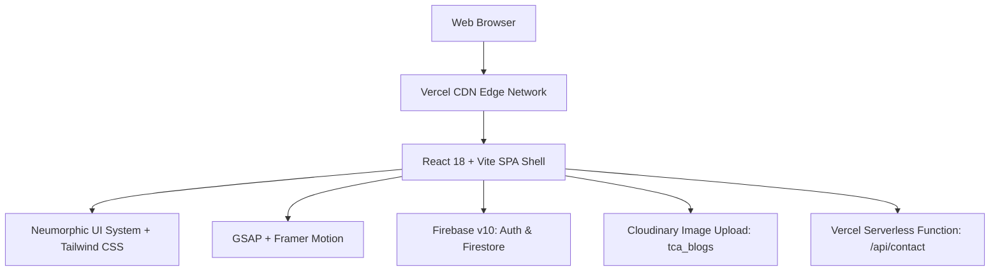

# Website Audit Findings & Migration Plan — The Consistent Academy

**Target Website:** [https://www.theconsistentacademy.in/](https://www.theconsistentacademy.in/)  
**Audit Completed:** October 11, 2026  
**Auditor:** Pair Programming Assistant (Antigravity)  
**Future Target Architecture:** React.js, Vite, Tailwind CSS, Lucide React  

---

## 1. Executive Summary

A comprehensive architectural and content audit of **The Consistent Academy** website was performed. The live production website is a Single Page Application (SPA) built with React 18, Vite, and Tailwind CSS, hosted on Vercel. 

The audit successfully decompiled and analyzed the live bundles (`index-7MsN_9H0.js` - 2.60 MB, and `index-BQGEii5i.css` - 135 KB), uncovering:
- **11 functional routes** plus a 404 fallback.
- **13 fully structured courses** (8 Adults/Professional, 5 Kids) with full curricula, pricing, and module breakdowns.
- **3 published books** with active marketplace links.
- **3 complete diagnostic test question banks** (25 Kids grammar questions, 28 Adults grammar questions, 60 Leadership diagnostic statements).
- **10 verified student testimonials** with band scores and international destinations.
- **5 active career recruitment profiles**.
- **53 verified, downloaded high-resolution image assets** (100% of all real assets on the live server), with 28 matching extensions and 17 extension mismatches normalized in `audit/verified_images/`.
- **An interactive visual contact sheet** generated at `audit/contact-sheet.html` for complete side-by-side verification.

---

## 2. Technical Stack Analysis of Original Website



### Key Technical Attributes
1. **Frontend Core:** React 18.3+, Vite build system, React Router DOM 6.
2. **Design Language:** Heavy **Neumorphism** (`neo-surface`, `neo-inset`, `rounded-neo-card`, `shadow-neu`). It relies on multiple layered soft box-shadows to emulate physical embossed surfaces.
3. **Animation Engines:**
   - **GSAP:** Powers the circular SVG preloader, SplitText word/character typography, and 3D curved gallery (`o6e` with bend factor 3).
   - **Framer Motion:** Powers layout transitions, scroll-triggered section fades, and modal overlays.
4. **Data Management:** TanStack React Query (`@tanstack/react-query`) handles blog pagination with Firestore cursors.
5. **Cloud Backend:**
   - **Firebase Project:** `the-consistent-academy` (Project ID: `the-consistent-academy`, App ID: `1:113362980454:web:14d6ade75d6763bd5ca7a7`).
   - **Firestore Collections:** `blogs`, `careerApplications`, `contactRequests`, `testResults`, `users`.
   - **Cloudinary:** Used for user blog image uploads (`cloud_name: dftodlkkt`, preset: `tca_blogs`).
   - **Vercel Serverless Functions:** Handles `POST /api/contact` for contact form emails.

---

## 3. Critical Issues & Architectural Gaps Discovered

### A. Search Engine Optimization (SEO) & Indexing Gaps
1. **Blank Initial HTML Shell:** The site serves an empty `<div id="root"></div>` without server-side rendering or static pre-rendering. Search crawlers that do not execute complex JavaScript cannot index page content, courses, or blogs.
2. **Canonical Domain Conflict:** The `<link rel="canonical">` tag in `index.html` hardcodes `https://consistentacademy.com`, whereas the live production domain, sitemap, and OpenGraph URLs point to `https://www.theconsistentacademy.in/`. This creates an indexing conflict and dilutes domain authority.
3. **Missing Heading Hierarchy:** The homepage hero hides its H1 with `sr-only` (`<h1 class="sr-only">The Consistent Academy - IELTS & English Learning</h1>`) while the visual headline is rendered through animated `span` tags inside a container with `Erica One`.

### B. Asset Formatting & Delivery Inefficiencies
1. **AVIF Files Encoded with `.png` Extensions:** Assets `/courses/img4.png`, `/courses/img5.png`, and `/courses/img6.png` are actually formatted as `ftypavif` (AVIF) files disguised with a `.png` file extension. While modern Chromium browsers render them, older browsers and image tools fail or misinterpret the mime-type.
2. **Lack of Responsive Image Serving:** Images are served in a single desktop resolution (e.g. 2000x927 for `img7.png`, 1600x1200 for gallery photos) to mobile screens without `<picture>` tags or `srcset`.
3. **Dead / Broken Code References:**
   - Code maps leadership styles to `/leadership/${m}.png`, but contains a fallback to `/leadership/laissez.png` for `laissezFaire`. The bundle includes a dead reference to `/leadership/laissezFaire.png` which returns Vercel's 200 HTML fallback.
   - An unreferenced `/test.jpg` exists in the bundle.
4. **Vercel Edge Throttling on Batch Requests:** Fetching more than 6 assets concurrently triggers edge rate limiting / timeouts, indicating that aggressive bot protection is configured on Vercel.

### C. Design & User Experience Limitations
1. **Neumorphism Usability Concerns:** Neumorphic shadows rely on low-contrast highlights and soft shadows on muted grey/off-white backgrounds (`#E0E5EC`). In bright daylight or on low-contrast mobile screens, buttons, cards, and interactive form fields blend together, impacting WCAG AA accessibility standards.
2. **Heavy Bundle Weight:** At 2.6 MB uncompressed, the client bundle is overloaded with GSAP plugins, SheetJS, and Firebase client SDKs, causing slower initial load on mobile networks.
3. **Incomplete Legal Compliance:** Footer links for "Privacy Policy" and "Terms of Service" point to placeholder hash links (`#`).

---

## 4. Migration Plan & Modern Architecture Blueprint

### Target Tech Stack:
- **Core Framework:** React 18 / 19 + Vite
- **Styling:** Vanilla CSS design system variables combined with modern Tailwind CSS
- **Iconography:** Lucide React (`lucide-react`)
- **Animation:** Lightweight CSS transitions & targeted Framer Motion micro-interactions
- **Backend:** Retain Firebase SDK abstraction layer, Cloudinary blog uploads, and contact endpoint

### Proposed Clean Project Structure:
```
consistent-academy-redesign/
├── public/
│   ├── books/             # Verified book covers
│   ├── courses/           # Standardized WebP course thumbnails
│   ├── gallery/           # Workshop & student photography
│   ├── leadership/        # High-contrast leadership badges
│   ├── logo.png           # Master brand logo
│   ├── logo2.png          # Circular emblem & favicon
│   ├── robots.txt         # Search bot crawler rules
│   └── sitemap.xml        # Updated route sitemap
├── src/
│   ├── assets/            # Static assets
│   ├── components/        # Reusable UI components
│   │   ├── common/        # Navbar, Footer, Button, Card, Modal
│   │   ├── home/          # Hero, CourseMarquee, Founder, Gallery, Testimonials
│   │   ├── courses/       # CourseCard, CourseFilter, CourseDetailModal
│   │   ├── tests/         # QuizRunner, ResultCard, LeadershipRadar
│   │   └── club/          # CCClubHero, MemberPortal, TrainerDashboard
│   ├── data/              # Typed datasets (courses.ts, tests.ts, testimonials.ts)
│   ├── hooks/             # useAuth, useQuiz, useTheme
│   ├── lib/               # firebase.ts, cloudinary.ts, utils.ts
│   ├── pages/             # Page route views (Home, Courses, Careers, Tests, Contact, Blog, Club)
│   ├── App.jsx            # Router and layout shell
│   ├── index.css          # Core CSS variables, typography & Tailwind directives
│   └── main.jsx           # App bootstrapping
├── audit/                 # Research, inventories, and verified image assets
├── package.json
└── vite.config.js
```

### Strategic Design System Transition:
| Element | Original Design (Neumorphic) | Redesigned Proposal (Modern & Accessible) |
|---------|------------------------------|-------------------------------------------|
| **Base Surface** | Flat grayish-blue `#E0E5EC` | Rich layered background (Crisp White / Slate 50 in light mode; Deep Indigo / Slate 950 in dark mode) |
| **Cards & Elevation** | Dual extruded box-shadows (`-8px -8px`, `8px 8px`) | Subtle glassmorphism (`backdrop-blur-md`), refined 1px border gradient (`border-white/10`), modern ambient soft glow |
| **Primary Color** | Royal Purple (`#9738F9` / `#6C63FF`) | Retained as Institutional Accent Purple (`#7C3AED` / `#9333EA`) paired with energetic Cyan/Emerald accents |
| **Typography** | Erica One (Display) + Fredoka (Body) | Google Font **Outfit** / **Plus Jakarta Sans** for headings, paired with **Inter** for exceptional readability |
| **Icons** | Mixed SVGs | 100% **Lucide React** icons with consistent stroke widths (1.75 - 2px) |

---

## 5. Verification Requirements Prior to Phase 2 (Implementation)

Before beginning the coding or design phase, the following operational details should be verified with the client:
1. **Hosting Platform Target:** Confirm whether the redesigned site will be deployed back to Vercel (to preserve serverless `/api/contact`) or if Netlify, Cloudflare Pages, or AWS is preferred.
2. **Canonical Domain Name:** Clarify whether `https://www.theconsistentacademy.in/` or `https://consistentacademy.com` is the official primary domain for SEO redirects.
3. **Physical Address & Google Business Profile:** Confirm whether a physical Pune address (with pincode) and Google Maps location should be embedded.
4. **Legal Pages Content:** Request actual Privacy Policy and Terms of Service copy to replace the current `#` dead links.
5. **High-Resolution Founder Portrait:** Request the master uncompressed file for Vidya Wankhade (`/gallery/vidya.png`).
6. **Active Firebase Credentials:** Verify whether the existing Firebase project (`the-consistent-academy`) should remain connected or if environment-specific development/production projects will be provisioned.
